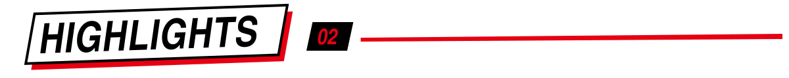

  

**At work** &nbsp; Data & AI engineering co-op: Microsoft Fabric lakehouses, Power BI semantic models and DAX, Dynamics 365 ingestion, and AI agents grounded on the prepared data.

**Leading** &nbsp; An EEG-to-robot project: an Emotiv EPOC X headset reads the wearer's mood, and a Temi robot says it out loud.

**Building** &nbsp; An AI judge and talent scout engine for [Cozy Arena](https://cozyarena.tech/), the hackathon platform I built from scratch. It scores submissions on the code people actually wrote.

**Ask me about** &nbsp; AI tooling, evaluating LLM output, robotics, and where UX and development meet.

| | |
|---|---|
| **Data & AI co-op** | Medallion-style Fabric lakehouses, semantic models, Copilot and custom agents on live client data |
| **Cozy Arena** | Live competition platform with cash prizes, sponsors and job postings for participants |
| **Robotics club exec** | Head of building: a competition robot, a Jetson Nano vision robot, an FPV simulator, a soccer robot |
| **Anthropic courses** | 19 short courses on the Claude API, Claude Code, MCP and agent design |

| Project | What it does | Stack |
|---|---|---|
| **Cozy Arena** &nbsp;`live` | Hackathon platform. Checks every upload's content signature, plus CSRF protection, rate-limited login, admin tools and CSV export | Flask, SQLAlchemy, SQLite |
| **AI Judge & Talent Scout** &nbsp;`in progress` | Scores real submissions and matches participants to sponsors' stacks from evidence in their code | Python, Claude API |
| **EEG-to-robot** &nbsp;`in progress` | Live headset metrics through a quality gate that goes offline instead of guessing; 11 automated tests | Python, Emotiv Cortex, WebSockets, React, TypeScript |
| **ASL Sign Translator** | Recognizes static signs from a webcam entirely in the browser. No frame ever leaves the device | React, TypeScript, MediaPipe |
| **Historical Influence Engine** | A world tree of 59 figures across 15 countries; a time slider re-ranks them live | React, Flask, Framer Motion |
| **SmartWrite** | 47-class handwriting CNN trained from scratch, behind a React frontend | PyTorch, React 19 |
| **Jetson Nano Vision Bot** &nbsp;`in progress` | Drives on its own; real-time face detection and age estimation on the GPU | Jetson Nano, OpenCV, Python |
| **Mood Project Picker** | Seven-question quiz to a three-axis vector, matched against 275 tagged projects | React, Flask |
| **Robotics builds** | Tetrix competition robot, VEX soccer robot with a kicker, FPV racing simulator | Arduino, C/C++, VEXcode |

Also: a Lua multiplayer survival game, FluxConvert (threaded TCP converter), a minimax chess engine, ARNS travel system (Java Swing), and Power BI dashboards.

  
  
  
  
  
  
  
  
  
  
  
  
  
  
  
  
  
  
  

