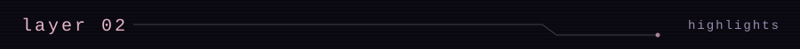
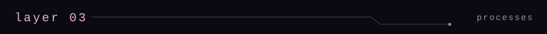
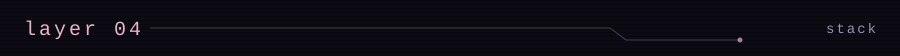

<p align="center">
  
</p>


```
> whoami
Karj-AI // AI + Data + Development + User Experience + Robotics

> now
Developing an ASL translator that runs entirely
in your browser via webcam
Building an AI Judge + talent scout engine
for a hackathon platform i built from scratch

> ask_me_about
AI tooling // Robotics // UX/Dev Crossover
```



```
Data & AI                  Fabric Lakehouses, Power BI + Dax models,
                           dynamics 365 ingestion, AI agents on top
Cozy Arena                 Hackathon platform: cash prizes, sponsors and
                           job postings surfaced to participants
Robotics Exec              Robotics: competition robot, Jetson Nano
                           Vision Robot, FPV Sim, Temi.
certifications             20 from anthropic (claude api, mcp, claude code)
```



```
001  Cozy Arena                flask platform. content-signature upload
                               checks, csrf, rate limiting, admin + csv
002  AI Judge & Talent Scout   llm backend: scores real submissions,
                               matches participants to sponsor stacks
003  Historical Influence      react + flask world tree: 59 figures,
     Engine                    15 countries, influence ranking
004  Smartwrite                47-class cnn from scratch in pytorch
                               + react 19 frontend
005  Jetson Nano Vision Bot    real-time face detection + age estimation
                               on-gpu (in progress)
006  ASL Sign Translator       in-browser sign recognition, mediapipe,
                               100% client-side
007  Mood Project Selection    quiz to 3-axis vector, 275 tagged projects
008  Multiple Robotics kits    Arduino || C++

also: lua survival game / fluxconvert (tcp) / arns travel (java)
      / power BI dashboards, fabric, Dynamics 365
```




<p align="left">
  
  
  
  
  
  
  
  
  
  
  
  
  
  
  
</p>


